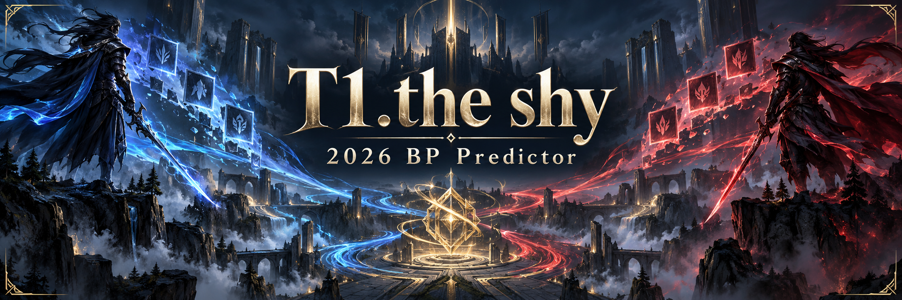

# T1.the shy 2026 BP Predictor



[English](README.md) · [简体中文](README.zh-CN.md) · [한국어](README.ko.md)

챔피언은 열 명. 훈수는 모델 한 명.

밴픽은 당신이, 큰소리는 모델이. 맞히면 명장, 틀리면 다음 판.


## 접속

Python 3.11–3.13와 Node.js 20.19+(또는 22.12+)를 준비하세요. 첫 실행 시 의존성·학습된 모델·경기 기록을 내려받습니다. 재학습은 없습니다.

```bash
git clone https://github.com/Immortal-Zhang/t1-the-shy-2026-bp-predictor.git
cd t1-the-shy-2026-bp-predictor
./start.sh
```

**http://127.0.0.1:5173** 에 접속하세요. Mac에서는 `start.command`를 더블 클릭해도 됩니다.

팀 선택 → 밴픽 완성 → 실제 모델의 한마디. 표준·공격적·극한 모드를 지원합니다. 지지 지수는 자신감의 표현이지 **승률이 아닙니다**. Bo5는 Fearless 사용 챔피언을 기억하며 시리즈 전체 승률은 예측하지 않습니다.

[모델·데이터 다운로드](https://github.com/Immortal-Zhang/t1-the-shy-2026-bp-predictor/releases/tag/runtime-2026-10-22-v1) · [기술 설명](docs/TECHNICAL.zh-CN.md)

비공식 팬 프로젝트로 T1·TheShy·Riot Games와 공식 관계가 없습니다. 경기 데이터: [ChainCC](https://chaincc.lol/free/data/) · CC BY 4.0. 챔피언 자료: Riot Data Dragon.
