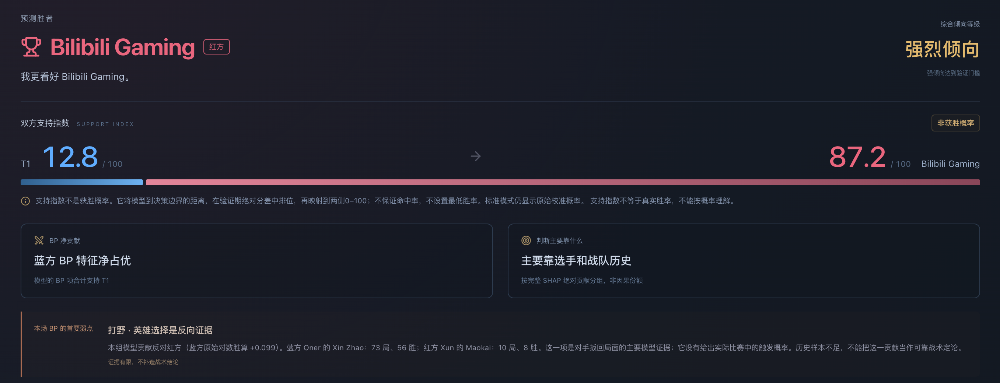

<div align="center">

# T1.the shy 2026 BP Predictor


[English](README.md) · [简体中文](README.zh-CN.md) · [한국어](README.ko.md)

Ten champions enter. One model has opinions.

Your draft has a plan. Your solo queue teammate does not. Let the real trained model take this one.



## Queue up

Have Python 3.11–3.13 and Node.js 20.19+ (or 22.12+) installed. First launch downloads dependencies, trained models and match history. No training arc required.

</div>

```bash
git clone https://github.com/Immortal-Zhang/t1-the-shy-2026-bp-predictor.git
cd t1-the-shy-2026-bp-predictor
./start.sh
```

<div align="center">

Open **http://127.0.0.1:5173**. Mac users can also double-click `start.command`.

Pick teams → finish BP → get a real prediction. Standard, aggressive and extreme modes included. The support index is attitude, **not win probability**. Bo5 remembers Fearless picks; it does not predict the whole series.

[Model & data download](https://github.com/Immortal-Zhang/t1-the-shy-2026-bp-predictor/releases/tag/runtime-2026-10-22-v1) · [Technical rabbit hole](docs/TECHNICAL.zh-CN.md)

Unofficial fan project. No affiliation with T1, TheShy or Riot Games. Match data: [ChainCC](https://chaincc.lol/free/data/) · CC BY 4.0. Champion assets: Riot Data Dragon.

</div>
