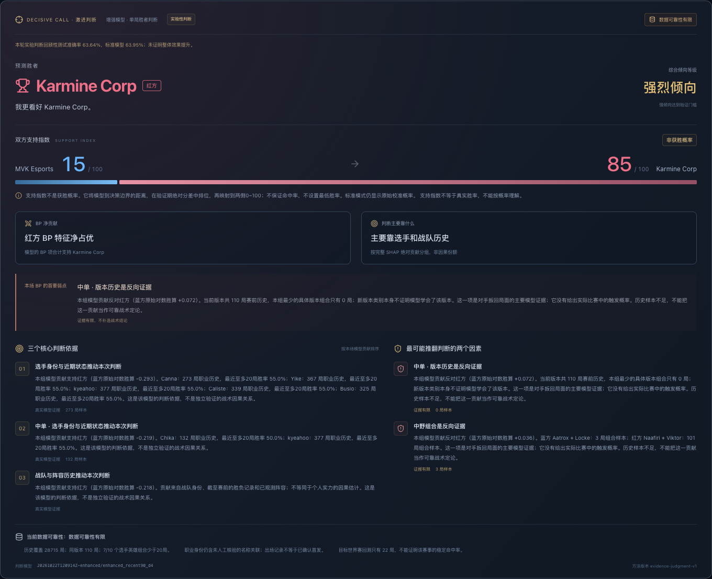

# LOL Worlds 2026 BP Predictor

[English](README.md) · [简体中文](README.zh-CN.md) · [한국어](README.ko.md)

A local League of Legends professional-match analysis workbench, trained on real historical games. Enter both teams, ten professional players, ten champions and the draft context to predict **one map** with auditable models.

中文：基于真实职业比赛训练的 BP 分析与单局预测工作台。[中文说明](README.zh-CN.md)。

한국어: 실제 프로 경기 데이터로 학습한 밴픽 분석 및 단일 경기 예측 도구입니다. [한국어 안내](README.ko.md).



## What it does

- Search verified Worlds teams and load dated, observed player lineups; every position remains editable.
- Choose ten champions and bans with Chinese/English search, portraits, role filters, duplicate checks and ban exclusions.
- Keep map side and draft first-pick entitlement separate. Editing inputs invalidates the previous result.
- Compare pre-BP and complete-BP models, inspect native CatBoost SHAP and real player/champion, matchup and pair histories.
- Save immutable predictions and drafts in browser storage; restore them and compare manually entered outcomes.
- Track previous picks for verified Bo3/Bo5 Fearless rules, including up to four previous maps in Bo5.
- Browse the recorded snapshot's **19 Worlds teams, 173 champions and 22 target-patch Worlds maps**.

**Scope:** interactive BP editing and complete-draft single-map inference are supported. Partial-draft, pick-by-pick live probabilities and whole-series Bo5 win probabilities are **not implemented**. Historical lineups are not confirmed current starters. The application UI is currently Chinese; the documentation is available in three languages.

## Three display modes

| Mode | Output |
|---|---|
| Standard | The original model's calibrated blue/red win probabilities. |
| Aggressive — default | An explicit winner, support indices, tendency grade, three evidence-based reasons, two opposing factors, BP contribution and data reliability. |
| Extreme | More direct wording and risk-first presentation, with the **same judgment, indices and thresholds** as aggressive mode. |

**A support index is not a win probability.** It expresses the model's decision margin as a percentile of validation-period margins. There is no minimum 65% probability and no conversion of a genuine 51% probability into a claimed 80% win probability. Original calibrated probabilities remain available in standard mode and technical details. Missing or invalid artifacts produce an explicit unavailable state, never fabricated predictions.

## Recorded evaluation

The normalized snapshot contains **28,738 real games**, ending at **2026-10-18 19:48:36 UTC**. The frozen models' training/selection/calibration label cutoff is **2025-12-30 00:00:00 UTC**. Chronological train / validation / calibration / test counts are **15,717 / 2,968 / 716 / 9,309**; boundary games with unavailable results are purged.

| Model · 9,309 test games | Accuracy | ROC-AUC | Log Loss | Brier |
|---|---:|---:|---:|---:|
| Original calibrated model | 63.95% | 0.697653 | 0.630171 | 0.220150 |
| Selected experimental judgment model | 63.64% | 0.692046 | 0.633306 | 0.221484 |

Original-model ECE is **0.03134**. Three enhanced candidates were actually trained, adding 190 history features for 374 total inputs. Selection used validation AUC and a validation Log Loss guard, not test performance. The selected candidate **did not demonstrate an overall improvement**. The 2026 test period had already been examined during the original project, so the enhancement comparison is retrospective, not new confirmatory evidence.

| Experimental judgment grade | Test games | Hit rate |
|---|---:|---:|
| Slight | 2,649 | 51.26% |
| Clear | 3,963 | 62.93% |
| Strong | 2,697 | 76.83% |

Strong calls cover 28.97% of the test set. The original model under the same policy achieved 78.02%, so stronger-call improvement is not established either. **Only 22 target-patch Worlds maps are available**; these results do not establish Worlds-specific reliability. Cohort hit rates are not probabilities for an individual match.

[Training comparison](reports/aggressive/experiment_results.md) · [Judgment evaluation](reports/aggressive/judgment_evaluation.md) · [Integrity audit](reports/aggressive/EXPERIMENT_AUDIT.md) · [Final acceptance](reports/acceptance/README.md)

## Install and prepare a fresh clone

Requirements: **Python 3.11+**, **Node.js 20.19+ on 20.x or 22.12+**, npm, and network access for source data and official champion assets. The recorded environment was macOS. No paid cloud service is required.

**The source repository does not include trained model binaries, raw match CSVs, processed datasets, virtual environments or `node_modules`.** Published reports and screenshots document an actual completed local run. A fresh clone must import real data and train before it can return predictions; archived metrics are not a substitute for a loaded model.

```bash
git clone https://github.com/Immortal-Zhang/lol-worlds-2026-bp-predictor.git
cd lol-worlds-2026-bp-predictor
python3.11 -m venv .venv
source .venv/bin/activate
python -m pip install -r requirements.lock.txt
python -m pip install -e '.[dev]'
npm --prefix frontend ci

worlds-bp download --years 2024 2025 2026
worlds-bp normalize --as-of 2026-10-22T00:00:00Z
worlds-bp train --config configs/train.json

# Enable the separate experimental aggressive judgment layer.
python scripts/train_aggressive.py
python scripts/evaluate_aggressive.py

./scripts/start_local.sh --production
```

Open **http://127.0.0.1:5173**; API documentation is **http://127.0.0.1:8026/docs**. Later launches only need `./scripts/start_local.sh --production`. The script reuses matching local services and stops only processes it starts. Restart an existing backend after changing its code. On this Mac, the script prefers Homebrew Node when available.

The aggressive training steps are optional for standard probabilities; without compatible judgment artifacts, aggressive mode explicitly reports its unavailability. The original and enhanced models are stored separately under `models/latest/` and `models/aggressive-experiment/latest/`. Cached reference JSON is included; refresh it deliberately with `python scripts/update_catalog.py` when needed.

If a source cannot be downloaded, use the documented **manual CSV import** workflow in the [technical guide](docs/TECHNICAL.zh-CN.md). Do not substitute invented games. Upstream files can be revised: new downloads and training are not guaranteed to reproduce the recorded snapshot exactly. Check provenance, coverage and evaluation generated by your own run.

## API and CLI

`POST /predict` returns standard calibrated probabilities. `POST /analyze` additionally returns model comparison, history, SHAP and an optional `judgment` object. Read-only endpoints include `/health`, `/catalog`, `/teams`, `/teams/{id}/roster`, `/matches` and `/players`.

Inputs include `as_of`, `scheduled_start`, `league`, `patch`, `first_pick_side`, and `blue` / `red` teams. Each team contains five `role` / `player_id` / `champion` entries and up to five bans. Roles are `top`, `jng`, `mid`, `bot`, `sup`; unknown bans use `null`. `/analyze` also accepts the validated `draft_context` for Fearless history.

```bash
# Build a request from an actual eligible historical game.
worlds-bp make-replay
worlds-bp predict examples/real_match_replay.json
curl -X POST http://127.0.0.1:8026/analyze \
  -H 'Content-Type: application/json' \
  --data-binary @examples/real_match_replay.json
```

No valid standard model means HTTP **503**, not fake odds; invalid inputs or incompatible prediction times return **422**. An unavailable experimental layer preserves valid standard analysis and returns `judgment.available=false`. Only trusted local model artifacts are loaded; the API does not accept model uploads.

## Data integrity and limitations

- One row per unique game; player and team records join on **`game_id` and `side`**. Quarantined records are reported rather than silently repaired.
- History must satisfy both `date < cutoff` and `available_at < cutoff`. Current-game KDA, gold, damage and outcomes never become pre-game inputs. Earlier results can update rolling history only after availability.
- `as_of` must follow the selected model's label cutoff and must not exceed the scheduled start. Model artifacts, feature implementations and judgment policy have integrity checks.
- Source professional names map to stable local identifiers. Same-name and renamed-player links still require independent verification; ranked accounts are not used.
- Worlds defaults to public patch **26.20**, explicitly mapped to source **16.20**. API startup checks the configured official announcement; a verified mismatch blocks Worlds prediction.
- BP model differences and SHAP are not causal effects. No validated engage/control ratings, early-to-late power curves or team-style counter scores are invented. User-entered outcomes are labeled as manual.

## Tests

The recorded local run passed **263 Pytest tests, 61 Vitest tests and 16 production Chrome/WebKit end-to-end tests**, plus the final two-browser Bo5 acceptance flow. TypeScript checking and the production build passed. Successful prediction tests used the real API; mock 503 responses were limited to failure-path checks.

```bash
source .venv/bin/activate
python -m pytest -q
npm --prefix frontend run test
npm --prefix frontend run build
cd frontend
npx playwright install chromium webkit
# Start both local services before this command.
npx playwright test --config playwright.aggressive.config.ts
```

Some model-dependent Python tests skip on a source-only clone until real artifacts are prepared. Browser end-to-end tests require the trained models, data and running services. WebKit coverage is not a claim of a complete native-Safari manual test. See the [test report](reports/aggressive/TEST_RESULTS.md).

## Stack and layout

**Backend:** Python, Pandas, DuckDB, CatBoost, Scikit-learn, FastAPI, Pytest. **Frontend:** React, TypeScript, Vite, Tailwind CSS, Zustand, Recharts, Vitest, Playwright.

```text
configs/              Reproducible training and event settings
data/                 Reference catalogs; local raw/processed match data
src/worlds_predictor/ Import, features, training, evaluation, CLI and API
frontend/             BP workbench, modes, local history and browser tests
models/               Locally generated trained artifacts
scripts/              Training, evaluation, catalog and startup commands
tests/                Data, time-leakage, model and API checks
reports/              Recorded metrics, provenance, audits and screenshots
docs/                 Detailed technical documentation
```

## Sources and usage terms

- Match data: [ChainCC Open Dataset](https://chaincc.lol/free/data/), recorded as **CC BY 4.0**. Attribution: “ChainCC. League of Legends esports match dataset. https://chaincc.lol/free/data/”. This project cleans, normalizes and derives historical features from that data. Source URLs, download dates and hashes are recorded by the import pipeline.
- [Oracle's Elixir](https://oracleselixir.com/tools/downloads) is an alternative import source. The recorded attempt returned HTTP 403; its terms must be checked independently rather than assumed to match ChainCC.
- Champion material: [Riot Data Dragon](https://developer.riotgames.com/docs/lol#data-dragon), subject to Riot's applicable policies. Team participation and Fearless references are recorded in the catalog. Neutral initials are used where team-logo reuse permission was not verified.
- **No software license has been selected for this repository.** Public source visibility does not grant a separate software license. Dataset and Riot-material terms remain independent.

This is an unofficial research and entertainment analysis tool, not a betting recommendation service. It is not endorsed by Riot Games. League of Legends and associated assets belong to Riot Games. Publishing this source repository does not establish approval for a hosted service; consult the [Riot developer policies](https://developer.riotgames.com/policies/general) before deploying one.
